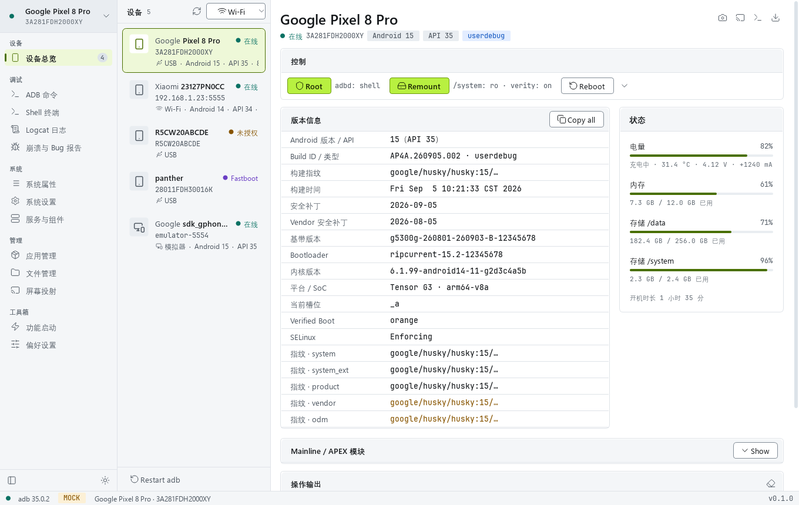
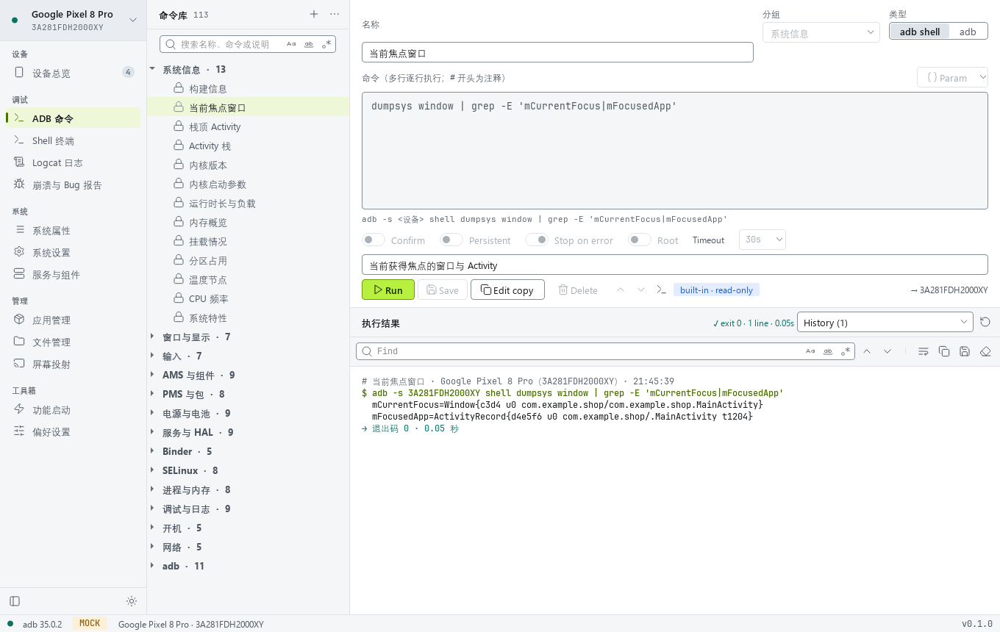
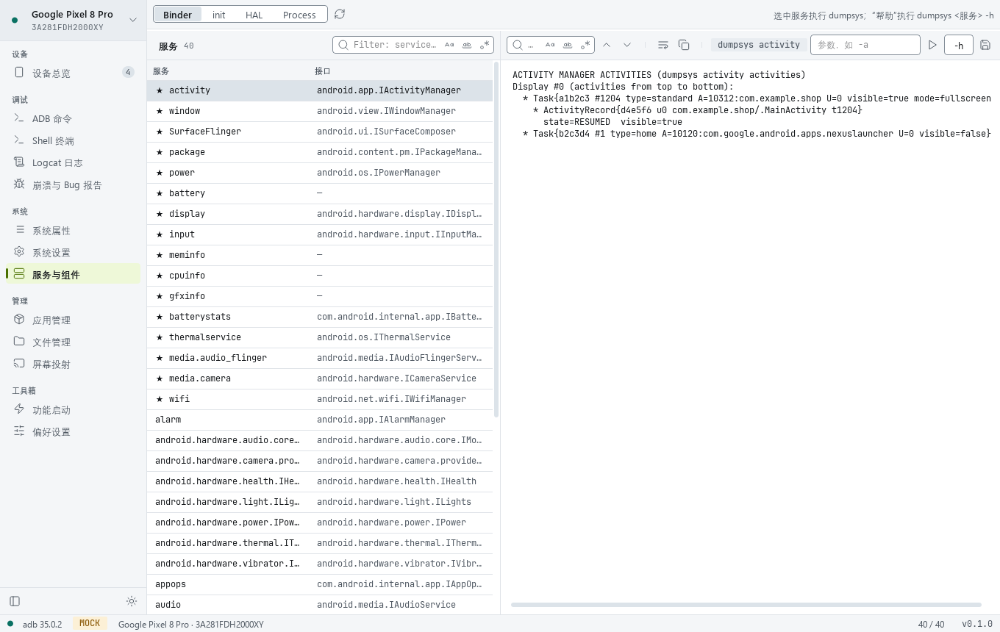
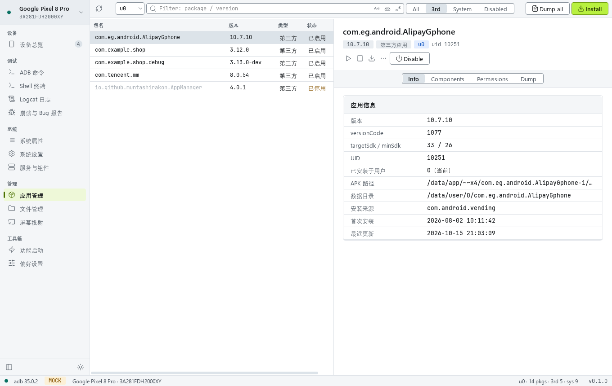
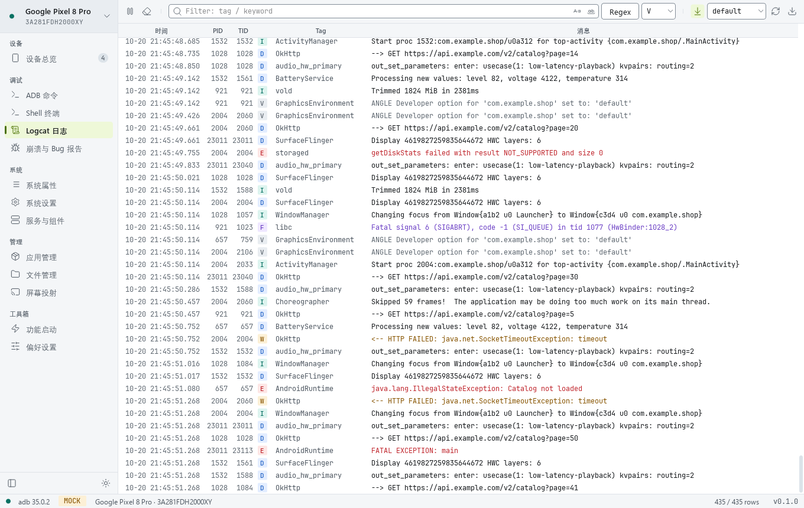
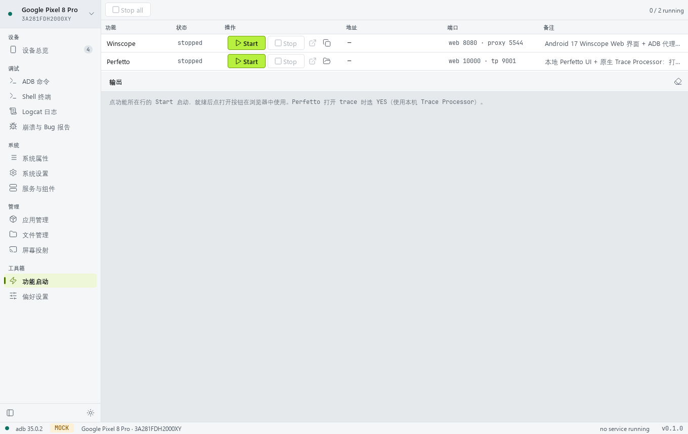
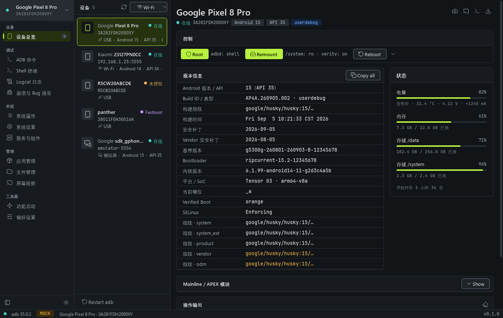

<div align="center">

<h1>SysDroidPro</h1>

<p><b>Android 系统工程师工具箱</b></p>

<p>面向 Android 系统开发工程师的 Windows 桌面工具：连上 userdebug 设备，快速查询系统各模块、组件的信息。</p>

[](https://github.com/cschengliang/SysDroidPro/releases/latest)


</div>



## 它能做什么

日常调试系统模块时，需要在 `dumpsys`、`getprop`、`service list`、`lshal`、`logcat`、`/data/tombstones` 之间来回切换。
SysDroidPro 把这些查询整理成界面，信息紧凑、可筛选、可对比，常用操作一键完成：

- **设备与 Root**：设备列表（USB / Wi-Fi / 模拟器 / Fastboot）、版本与各分区指纹、一键 Root / Remount（需要重启时自动继续）、连接后自动 adb root
- **系统信息**：系统属性（含 SELinux 上下文、监视、快照对比）、settings 三个命名空间（按用户）
- **服务与组件**：Binder 服务 + dumpsys、init 服务启停、HIDL / AIDL HAL、进程详情（线程、加载的 .so、调用栈）
- **应用**：按 Android 用户列包、组件启停、运行时权限开关、原始 dump、批量 dump
- **ADB 命令库**：113 条按系统模块分组的内置命令；参数可从设备列表选择（包名 / 服务 / PID / 属性）；需要 root 时自动提示
- **日志与崩溃**：Logcat（级别、正则、缓冲区含 dmesg、导出）、tombstone / ANR / dropbox、生成 bugreport
- **其它**：Shell 终端、文件管理、scrcpy 投屏、一键启动本地 Winscope 与 Perfetto

## 下载使用

1. 到 [Releases](https://github.com/cschengliang/SysDroidPro/releases/latest) 下载 `SysDroidPro-<版本>-win64.zip`（免安装绿色版，约 80 MB）。
2. 解压到任意目录（路径可以有中文和空格），双击 `SysDroidPro.exe`。

已附带 adb（platform-tools 37）、scrcpy 4.1、Winscope（Android 17）和本地 Perfetto v58.2，不需要另外安装 Python 或 Android SDK。

```bat
SysDroidPro.exe             :: 连接真实设备
SysDroidPro.exe --mock      :: 演示数据，不需要设备
SysDroidPro-debug.bat       :: 带控制台启动，出现异常时可以看到堆栈
```

- 设置、命令库、执行历史保存在 `droidtoolbox\data\`，升级时把这个目录复制到新版本即可保留。
- 系统要求：Windows 10 / 11 x64（启动器依赖系统自带的 .NET Framework 4.x）。
- 启动器没有数字签名，首次运行时 Windows SmartScreen 可能提示“未知发布者”，选择“仍要运行”即可。
- 设备需要开启 USB 调试；Root / Remount 等功能需要 userdebug 或 eng 固件。

## 界面

| | |
| --- | --- |
|  |  |
| **ADB 命令库**：内置命令、带类型参数、执行历史 | **服务与组件**：Binder / init / HAL / 进程 |
|  |  |
| **应用管理**：按用户、组件、权限 | **Logcat**：级别、正则、缓冲区 |
|  |  |
| **功能启动**：本地 Winscope / Perfetto | **深色主题**（Ctrl+T 切换） |

> 截图使用演示数据（`--mock`），状态栏的 MOCK 标记表示未连接真实设备。

## 功能一览

| 分组 | 页面 | 内容 |
| --- | --- | --- |
| 设备 | 设备总览 | 设备列表；Root / Remount / 重启与状态；版本信息（各分区指纹不一致时标出）；Mainline / APEX 模块；截图、投屏、Shell 快捷入口 |
| 调试 | ADB 命令 | 113 条内置命令（系统信息、窗口与显示、输入、AMS、PMS、电源、服务与 HAL、Binder、SELinux、进程与内存、调试与日志、开机、网络、adb）+ 我的命令；`{包名:package}` 等带类型参数；多行、持续运行可停止；历史可重新执行；复制 adb 命令行；导入导出 JSON |
| | Shell 终端 | 持久会话，“常用命令”读取命令库 |
| | Logcat 日志 | 级别下拉、文字 / 正则过滤、缓冲区（main / system / crash / events / kernel / dmesg …）、暂停、导出 |
| | 崩溃与 Bug 报告 | tombstone / ANR / dropbox 预览，生成并拉取 bugreport |
| 系统 | 系统属性 | getprop、SELinux 上下文列、监视所选属性、快照对比、setprop |
| | 系统设置 | settings system / secure / global，按用户，常用开关，快照对比 |
| | 服务与组件 | Binder 服务（dumpsys）、init 服务（启停）、HAL（lshal / AIDL）、进程（status、线程、.so、调用栈） |
| 管理 | 应用管理 | 自动识别 Android 用户；概览 / 组件（启停）/ 权限（含未授予的运行时权限）/ 原始 dump；安装、导出 APK |
| | 文件管理 | 浏览、上传下载、新建、重命名、删除（root 后可浏览 /system、/vendor、/data） |
| | 屏幕投射 | scrcpy 独立窗口，记住窗口位置大小，按键面板 |
| 工具箱 | 功能启动 | 每个服务独立启动 / 停止：Winscope（Web 界面 + ADB 代理）、本地 Perfetto（UI + 原生 Trace Processor） |
| | 偏好设置 | 工具路径、主题、自动 adb root、端口、导出目录 |

## 从源码运行

仓库不包含嵌入式 Python 和附带工具（体积较大），需要先准备环境：

```
SysDroidPro/
├─ python-3.14.8-embed-amd64/     ① 嵌入式 Python（自行下载）
├─ android-toolbox-qt-style/      界面样式包 tbui
└─ droidtoolbox/                  程序
   └─ tool/                       ② 附带工具（可选）
```

1. 下载 Python 3.14 Windows embeddable package（x64），解压为仓库根目录下的 `python-3.14.8-embed-amd64/`。
   编辑其中的 `python314._pth`：添加一行 `Lib\site-packages`，并取消 `import site` 的注释。
2. 安装依赖：
   ```bat
   cd python-3.14.8-embed-amd64
   curl -O https://bootstrap.pypa.io/get-pip.py
   python.exe get-pip.py
   python.exe -m pip install PySide6==6.12.0
   python.exe -m pip install pytest pytest-timeout pyflakes     :: 开发与测试用
   ```
3. （可选）在 `droidtoolbox/tool/` 放入附带工具：`platform-tools/`、`scrcpy-win64-v4.1/`、`tools/winscope-android17/`、`perfetto-local/`（`ui/` 与 `bin/windows-amd64/trace_processor_shell.exe`）。
   不放也可以：程序会依次在 PATH、`ANDROID_HOME`、Android Studio 默认 SDK 中查找 adb，也可以在偏好设置里指定路径。
4. 启动：
   ```bat
   cd droidtoolbox
   run.bat               :: 无控制台窗口
   run.bat --mock        :: 演示数据
   run-debug.bat         :: 带控制台
   ```

## 构建发布版

```bat
cd droidtoolbox
..\python-3.14.8-embed-amd64\python.exe packaging\build_release.py
```

输出 `dist/SysDroidPro-<版本>-win64/` 与同名 `.zip`：精简运行时（PySide6 只保留 QtCore / QtGui / QtWidgets / QtSvg）、预编译 `.pyc`、附带工具，
以及用 .NET Framework 自带 `csc` 编译的启动器 `SysDroidPro.exe`。构建结束会用打包后的运行时无窗口启动并逐页打开做自检。版本号取自 `droidtoolbox/app/__init__.py`。

## 测试

```bat
cd droidtoolbox
..\python-3.14.8-embed-amd64\python.exe -m pytest -q                              :: 离线测试（后端解析、数据层、界面）
set DTB_DEVICE=emulator-5554
..\python-3.14.8-embed-amd64\python.exe -m pytest -q -m device                    :: 连接设备的只读测试
set DTB_DESTRUCTIVE=1                                                             :: 另含会修改设备状态（且会还原）的测试
```

## 项目结构

```
droidtoolbox/
├─ main.py                 入口
├─ app/
│  ├─ backend/             设备后端：api.py（接口契约）、adb.py（真实后端）、mock.py（演示数据）、parsers.py
│  ├─ core/                线程任务、设备状态、设置、命令库、内置命令、本机服务（Winscope / Perfetto）
│  ├─ ui/                  通用组件（表格、文本查看器、对话框、参数输入框 …）
│  └─ pages/               各页面
├─ packaging/              构建脚本与启动器源码
├─ tests/                  backend / core / ui / device 测试与设备输出样本
└─ docs/                   后端规格与实现报告
android-toolbox-qt-style/tbui/   设计令牌、QSS、控件、Lucide 图标、JetBrains Mono 字体
```

更详细的开发说明见 [droidtoolbox/README.md](droidtoolbox/README.md)。

## 第三方组件

发布包附带或使用了以下组件，版权归各自作者，按各自许可证分发：

- [Qt for Python (PySide6)](https://www.qt.io/qt-for-python) — LGPLv3
- [Python](https://www.python.org/) — PSF License
- [Android SDK Platform-Tools](https://developer.android.com/tools/releases/platform-tools)、[Perfetto](https://perfetto.dev/)、Winscope — Apache 2.0
- [scrcpy](https://github.com/Genymobile/scrcpy) — Apache 2.0
- [Lucide](https://lucide.dev/) 图标 — ISC；[JetBrains Mono](https://www.jetbrains.com/lp/mono/) 字体 — OFL 1.1
