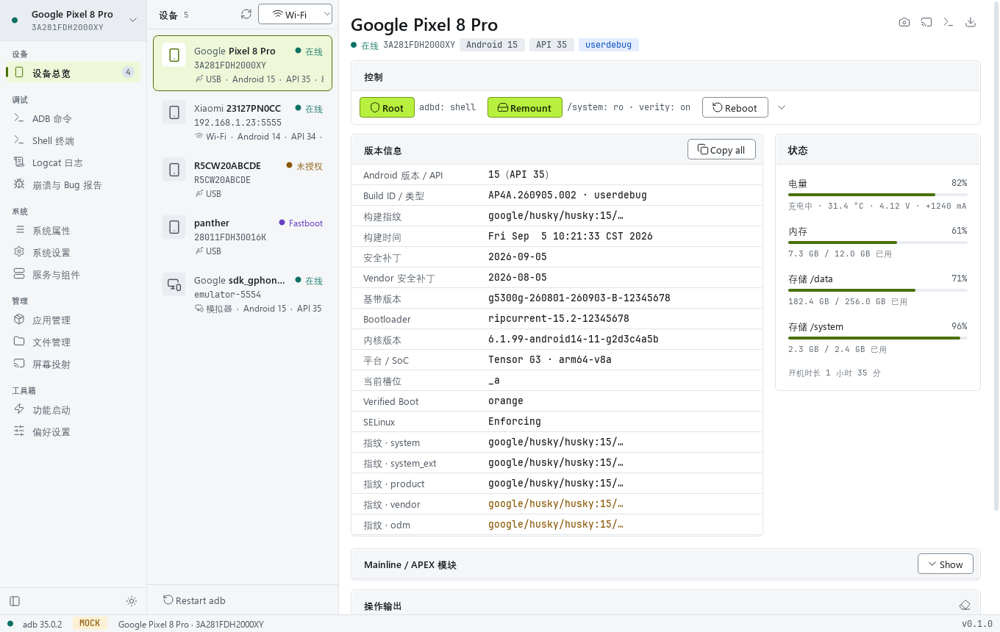

# SysDroidPro

面向 Android 系统工程师的 Windows 调试工具箱。用图形界面查看设备、系统服务、应用和日志，集中执行常用 ADB 操作。

## 核心功能

- **设备调试**：查看设备版本、分区指纹和 APEX 模块，一键 Root / Remount。
- **系统与应用**：查看属性、设置、Binder / init 服务、HAL 和进程，管理应用组件与权限。
- **命令与日志**：ADB 命令库、Shell、Logcat 过滤与导出、崩溃记录和 bugreport。
- **实用工具**：文件管理、scrcpy 投屏、本地 Winscope 和 Perfetto。

## 下载与使用

从 [GitHub Releases](https://github.com/cschengliang/SysDroidPro/releases/latest) 下载 `SysDroidPro-<版本>-win64.zip`，解压后运行 `SysDroidPro.exe`。支持 Windows 10 / 11 x64，无需另装 Python 或 Android SDK。

- **连接设备**：开启 USB 调试；Root / Remount 需要 `userdebug` 或 `eng` 固件。
- **无设备体验**：运行 `SysDroidPro.exe --mock`。
- **升级保留数据**：将旧版的 `droidtoolbox/data/` 复制到新版对应目录。

## 开发

[源码运行、构建与项目结构](droidtoolbox/README.md) · [测试说明](droidtoolbox/docs/TEST_PLAN.md)
